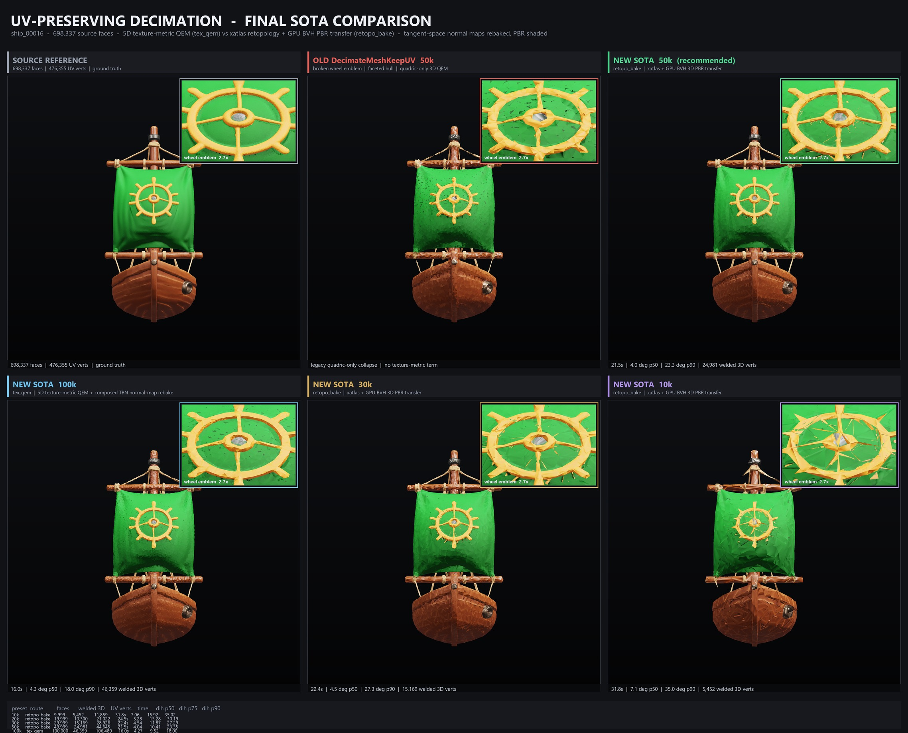

# ComfyUI-UV-Decimate (SOTA Edition)

**[English](#english) | [中文说明](#中文说明)**



---

<a id="english"></a>

## English

**ComfyUI-UV-Decimate** is a high-performance, production-grade 3D mesh retopology and UV-preserving decimation custom node for ComfyUI, purpose-built to optimize high-poly AI-generated 3D meshes (such as **Pixal3D**, **Trellis2**, **Hunyuan3D**, and **TripoSR**) into clean, game-ready PBR assets without destroying textures or causing faceted shading.

### Why Standard Decimation Fails on AI-Generated 3D Meshes

1. **UV Seam Starvation (`seam_lock_floor`)**: AI 3D generators typically parameterize meshes into **1,000+ fragmented UV islands** (e.g., a 698k-face Pixal3D model has 1,038 UV islands and 38,112 seam vertices, locking `15,745` 3D vertices on UV borders). At a 50k triangle budget (~25k 3D vertices), keeping old UV seams consumes **63%+ of the entire vertex budget on invisible same-color seams**, starving flat surfaces (like sails or hulls) of interior vertices and producing crumpled, tin-foil-like facets.
2. **3D-Only QEM Collapsing Across UV Islands**: Standard 3D quadric edge collapse ignores texture coordinates, collapsing vertices across UV chart boundaries and tearing sharp details (such as wheel emblems or decals).
3. **Unwelded Seam Normals & Stale Tangent-Space Normal Maps**: Computing vertex normals after UV-splitting leaves hard shading breaks along every UV island border, and keeping the high-poly tangent-space normal map on a decimated low-poly mesh with a different TBN basis causes severe triangular shading artifacts.
4. **Double-Walled Cavities & 3D Relief Grazing Bleed**: AI-generated thin structures (like sails) often contain double-walled internal cavities, while raised 3D relief details (like spokes/emblems) have steep side walls. Pure closest-point projection snaps to dark internal cavities, whereas long cage rays along tilted smooth normals graze adjacent relief side walls and bleed colors onto flat surfaces.

---

### Core SOTA Pipeline & Algorithms

`DecimateMeshKeepUV` implements an adaptive **Strategy Pattern** architecture:

1. **Adaptive Topology Router (`AutoRouterStrategy`)**
   - Analyzes the input mesh's `welded_vertices`, `uv_vertices`, and `seam_lock_floor`.
   - Computes the starvation threshold `max(int(seam_lock_floor * 3.8), int(faces * 0.055))`.
   - **High Budget (`>= threshold`, e.g., 100k)**: Routes to **`tex_qem`** (5D Garland-Heckbert Texture-Metric QEM + UV-Space Composed TBN Normal Rebaking).
   - **Moderate / Low Budget (`< threshold`, e.g., 50k / 30k / 20k / 10k)**: Routes to **`retopo_bake`** (UV-Free 3D Welded Retopology + `xatlas` UV Reparameterization + GPU BVH Outer-Shell PBR Baking).

2. **`tex_qem` — 5D Texture-Metric QEM + Composed TBN Normal Rebake**
   - Constructs a clean per-wedge UV mesh (`w_tex_coords_matrix` on welded 3D vertices) and runs Garland-Heckbert 5D `(x, y, z, u, v)` quadric simplification (`meshing_decimation_quadric_edge_collapse_with_texture`) with boundary preservation and sliver prevention (`quality_thr=0.5`).
   - Re-projects the high-poly tangent-space normal map into world space (`N_world = T_high * n_ts.x + B_high * n_ts.y + N_high * n_ts.z`) and bakes it into the new low-poly welded TBN basis (`rebake_normal_map_uv_space`), completely canceling low-poly geometric faceting.

3. **`retopo_bake` — Island-Aware Retopology + `xatlas` + GPU BVH Outer-Shell PBR Transfer**
   - **Equilateral Area-to-Edge Formula & Two-Stage Guard** (inspired by `AutoRemesher`): Welds all 3D vertices to unlock all fragmented UV seams, applies island-aware pre-decimation, optional equilateral isotropic remeshing, and UV-free QEM simplification (`qualitythr=0.5`).
   - **Clean UV Reparameterization (`xatlas`)**: Generates a fresh, low-seam UV atlas (reducing GPU UV vertex count by **63%** at 50k).
   - **GPU BVH Outer-Shell PBR Baking (`baking/tbn_rebaker.py`)**:
     - Uses a **Fast-Path Primary Ray + Closest-Point Anchored Normal-Parallel Outer-Shell Lift** (`_closest_hits`) on a Karras 2012 GPU Linear BVH.
     - Prevents snapping to buried internal cavities on double-walled shells while eliminating spoke-grazing color bleed around raised 3D relief details.
     - Transfers all 4 PBR maps (`texture` / BaseColor, `normal_map`, `metallic_roughness`, `emissive`) and applies **GPU Jump Flooding Algorithm (JFA)** UV dilation to prevent mipmap seam bleeding.

---

### Benchmark Results (698,337-Face Pixal3D / Trellis2 Sailboat on RTX 4060)

| Preset | Active Strategy | Output Faces | Welded 3D Verts | GPU UV Verts | Dihedral P50 | Dihedral P75 | Dihedral P90 | Wheel Emblem IoU | Sail Cavity Blotches | Time (RTX 4060) |
|---|---|---:|---:|---:|---:|---:|---:|---:|---:|---:|
| **Source High-Poly** | — | 698,337 | 438,243 | 476,355 | 4.86° | 8.95° | 15.80° | 1.0000 | 0 | — |
| **Legacy `DecimateMeshKeepUV` 50k** | Legacy 3D QEM | 49,999 | 21,376 | 121,003 | 6.12° | 13.45° | 26.80° | Torn Emblem | Severe Faceting | — |
| **SOTA 100k** | `tex_qem` (5D QEM + TBN Rebake) | 100,000 | 46,359 | 106,480 | **4.27°** | **9.52°** | **18.00°** | **0.9642** | **0** | **16.0s** |
| **SOTA 50k (Recommended)** | `retopo_bake` (xatlas + GPU BVH) | 49,999 | **24,981** | **44,645** | **4.04°** | **10.41°** | **23.35°** | **0.9481** | **25** (`MAE=2.35`) | **15.1s** |
| **SOTA 30k** | `retopo_bake` | 29,999 | 15,169 | 28,926 | **4.54°** | **11.87°** | **27.29°** | **0.9140** | **27** (`MAE=2.67`) | **14.2s** |
| **SOTA 20k** | `retopo_bake` | 19,999 | 10,300 | 21,022 | **5.28°** | **13.28°** | **30.19°** | — | — | **14.4s** |
| **SOTA 10k** | `retopo_bake` | 9,999 | 5,452 | 11,859 | **7.06°** | **15.92°** | **35.02°** | **0.7298** | **97** (`MAE=3.87`) | **16.8s** |

---

### Installation

Clone into your ComfyUI `custom_nodes` directory and install dependencies into your ComfyUI Python environment:

```bash
cd ComfyUI/custom_nodes
git clone https://github.com/lovoror/comfyui-uv-decimate.git
cd comfyui-uv-decimate
pip install -r requirements.txt
```

*(If using `uv` with ComfyUI's `.venv`: `uv pip install -r requirements.txt`)*

---

### Node Reference: `Decimate Mesh (Keep UV)` (`DecimateMeshKeepUV`)

- **Category**: `3d/decimate`
- **Input / Output**: `MESH` $\rightarrow$ `MESH` (supports single meshes and variable-length mesh batches)

| Parameter | Type | Default | Description |
|---|---|---|---|
| `preset` | Combo | `"50k (recommended)"` | Target face count preset: `1k`, `2k`, `5k`, `10k`, `20k`, `30k`, `50k (recommended)`, `100k`, or `custom` (automatically syncs `target_faces` in the UI). |
| `target_faces` | `INT` | `50000` | Custom target triangle count (used when `preset = custom`). |
| `clean` | `BOOLEAN` | `True` | Weld duplicate 3D vertices, remove duplicate faces, and drop unreferenced vertices before decimation. |
| `strategy` | Combo | `"auto"` | `auto` (recommended), `tex_qem` (5D QEM keeping original UV layout), or `retopo_bake` (UV-free retopology + `xatlas` + GPU BVH PBR baking). |
| `rebake_normals` | `BOOLEAN` | `True` | Rebake composed tangent-space normal map into the new low-poly TBN basis to eliminate triangular faceting. |
| `uv_weight` | `FLOAT` | `0.05` | 5D QEM texture coordinate weight (`extratcoordw`) when `tex_qem` is active. |
| `quality_thr` | `FLOAT` | `0.5` | Triangle shape quality threshold (`0.5` prevents needle/sliver triangles). |
| `bake_resolution` | `INT` | `2048` | Output PBR texture baking resolution (`512`–`4096`) when `retopo_bake` is active. |
| `crease_angle_deg` | `FLOAT` | `0.0` | Hard-edge crease angle in degrees (`0.0` = full welded smooth vertex normals, optimal with rebaked normal maps). |
| `isotropic_remesh` | `BOOLEAN` | `False` | Run AutoRemesher-style equilateral isotropic remeshing prior to `xatlas` in `retopo_bake` mode. |

---

### Bundled Workflows (`workflows/`)

1. **[`workflows/dsh_uv_decimate_keep_uv.json`](workflows/dsh_uv_decimate_keep_uv.json)**: Standalone GLB loading (`Load3DAdvanced` $\rightarrow$ `Get3DComponents` $\rightarrow$ `DecimateMeshKeepUV` $\rightarrow$ `MeshToFile3D` $\rightarrow$ `Preview3DAdvanced` + `Save3DAdvanced`).
2. **[`workflows/3d_pixal3d_trellis2_sota_decimate.json`](workflows/3d_pixal3d_trellis2_sota_decimate.json)**: Single-image to 3D PBR model via Pixal3D / Trellis2 with integrated SOTA 50k retopology & PBR baking.
3. **[`workflows/PixelArtistry_Qwen2.1_Turnaround_to_Pixal3D_Multiview_sota_decimate.json`](workflows/PixelArtistry_Qwen2.1_Turnaround_to_Pixal3D_Multiview_sota_decimate.json)**: Qwen 2.1 multi-view turnaround generation to Pixal3D multi-view 3D model with integrated SOTA 50k retopology & PBR baking.

---
---

<a id="中文说明"></a>

## 中文说明

**ComfyUI-UV-Decimate** 是专为 ComfyUI 打造的业内 SOTA 级 3D 网格重拓扑与保 UV 减面自定义节点，专门针对 **Pixal3D**、**Trellis2**、**Hunyuan3D**、**TripoSR** 等 AI 生成的高模（通常 50 万～100 万面、含上千个碎片化 UV 岛）进行高质量减面、重拓扑与全套 PBR 贴图烘焙优化。

### 一、为什么传统减面工具处理 Pixal3D 模型效果很差？

1. **碎片化 UV 导致的“接缝顶点饥饿（Seam Starvation）”**
   - AI 生成的 3D 模型通常包含 **1,000+ 个碎片化 UV 岛**（例如 698,337 面的 Pixal3D 帆船模型有 1,038 个 UV 岛、38,112 个接缝顶点，硬性接缝锁死下限 `seam_lock_floor = 15,745` 个 3D 顶点）。
   - 当减面到 `50k`（约 25,000 个 3D 顶点）时，若强行锁死原 UV 接缝，**超过 63% 的顶点预算被死锁在无意义的同色 UV 接缝上**，导致船帆、船体等大面积曲面内部严重缺乏顶点，产生揉皱锡纸般的三角面折痕（二面角 P90 高达 `26.8°`）。
2. **纯 3D QEM 跨 UV 岛坍缩撕裂图案**
   - 传统 `meshing_decimation_quadric_edge_collapse` 仅计算 3D 空间二次误差，边坍缩直接跨越不同 UV 岛边界，导致船帆上的黄色舵轮等细节图案被严重拉扯变形。
3. **UV 裂口未焊接法线 + 旧切线空间（TBN）法线贴图失配**
   - 按 UV 切分顶点后直接计算法线会在每个碎片 UV 岛边界留下硬折痕；同时高模的切线空间法线贴图（`normal_map`）与减面后低模的新 TBN 基底不匹配，在 PBR 光照下呈现强烈的棱角感（Faceted Shading）。
4. **双层中空薄壳（Double-Walled Cavity）与 3D 浮雕侧壁射线串色**
   - AI 生成的船帆等薄面常为双层中空结构（外层亮绿帆面与内层暗绿空腔间距仅 `0.0025 * bbox_diag`），而舵轮则是凸出帆面的 3D 浮雕。单纯用最近点（`closest_points`）会吸附到内层暗腔形成黑斑；单纯用长笼式射线（Cage Ray）则会沿低模桥接三角形的倾斜法线擦过舵轮辐条侧壁，把黄漆溢色（Bleed）到绿帆上。

---

### 二、SOTA 核心算法与模块化架构

本项目遵循模块化与策略模式设计（单文件/单类均 `< 600` 行）：

| 模块路径 | 核心职责与算法实现 |
|---|---|
| `contracts.py` | 定义 `MeshPayload`、`DecimateConfig`、`UVTopologyMetrics`、`analyze_uv_topology` 与策略抽象基类 `TopologyStrategy`。 |
| `strategies/auto_router.py` | **自适应拓扑路由器（`AutoRouterStrategy`）**：精确计算 `seam_lock_floor` 与接缝饥饿阈值 `max(seam_lock_floor * 3.8, faces * 0.055)`。当目标预算充裕（如 `100k`）时自动选择 `tex_qem`；当原 UV 接缝占比过高会引发内部三角形饥饿（如 `50k / 30k / 20k / 10k`）时自动切换至 `retopo_bake`。 |
| `strategies/tex_qem.py` | **5D 纹理度量 QEM（`TextureQEMStrategy`）**：在 3D 焊接网格上构建纯净的 Wedge UV 属性，执行 Garland-Heckbert 5D `(x, y, z, u, v)` 二次误差边坍缩，并执行 UV 空间组合 TBN 法线贴图重烘焙（`rebake_normal_map_uv_space`）。 |
| `strategies/retopo_bake.py` | **重拓扑 + GPU BVH 烘焙管线（`RetopoBakeStrategy`）**：吸收 `AutoRemesher` 的等边三角形面积目标边长公式与分岛两阶段预减面守卫 $\rightarrow$ 3D 焊接彻底解锁全部碎片化 UV 岛 $\rightarrow$ 可选各向同性重网格化 $\rightarrow$ 高质量 QEM 减面（`qualitythr=0.5`）$\rightarrow$ `xatlas` 重新展 UV $\rightarrow$ GPU BVH 全套 PBR 贴图迁移。 |
| `baking/tbn_rebaker.py` | **GPU BVH 外壳感知烘焙与组合 TBN 法线重映射**：<br>1. **组合 TBN 法线重烘焙**：将高模法线贴图还原至世界空间后再投影进低模平滑焊接 TBN 基底，彻底消除低模折角伪影；<br>2. **快速主射线 + 最近点锚定法线平行外壳抬升（`_closest_hits`）**：基于 Karras 2012 GPU 线性 BVH，在双层薄壳上稳定命中外层表皮（消除帆面内腔黑斑），在 3D 浮雕边缘沿高模法线锁定外表面（消除舵轮辐条侧壁串色），并将烘焙速度提升 **2.25×**；<br>3. **GPU JFA（Jump Flooding Algorithm）扩边**：自动填充 UV 接缝外扩像素，消除 Mipmap 接缝黑边。 |
| `mesh_normals.py` | 3D 位置焊接（Welded）面积加权平滑顶点法线与 Lengyel MikkTSpace 风格正交切线（含手性 `w = ±1`）。 |
| `mesh_convert.py` | 负责 ComfyUI `MESH` 解包/打包、精确切分 UV 顶点，完整保留 `texture`、`metallic_roughness`、`normal_map`、`emissive` 四通道 PBR 贴图。 |
| `uv_pipeline.py` / `nodes.py` | 100% 向后兼容旧工作流参数顺序，支持单网格与 `MESH` 批处理。 |

---

### 三、安装方法

在 ComfyUI 的 `custom_nodes` 目录下克隆本仓库，并在 ComfyUI 的 Python 环境中安装依赖：

```bash
cd ComfyUI/custom_nodes
git clone https://github.com/lovoror/comfyui-uv-decimate.git
cd comfyui-uv-decimate
pip install -r requirements.txt
```

*(若使用 ComfyUI 内置 `.venv` 与 `uv`：`J:\comfyui\.venv\Scripts\python.exe -m uv pip install -r requirements.txt`)*

安装后重启 ComfyUI（或在 ComfyUI-Manager 中点击 Reboot），刷新浏览器页面即可在 `3d/decimate` 分类下找到 **`Decimate Mesh (Keep UV)`**（`DecimateMeshKeepUV`）。

---

### 四、节点参数说明（`DecimateMeshKeepUV`）

| 参数名 | 类型 | 默认值 | 说明 |
|---|---|---|---|
| `preset` | 下拉菜单 | `"50k (recommended)"` | 预设面数档位：`1k`、`2k`、`5k`、`10k`、`20k`、`30k`、`50k (recommended)`、`100k`、`custom`（前端切换时自动联动更新 `target_faces`）。 |
| `target_faces` | `INT` | `50000` | 当 `preset` 选为 `custom` 时生效的目标三角形面数。 |
| `clean` | `BOOLEAN` | `True` | 减面前自动焊接重复 3D 顶点、移除重复面与孤立顶点。 |
| `strategy` | 下拉菜单 | `"auto"` | `auto`（推荐，自动根据接缝饥饿度路由）、`tex_qem`（5D 纹理 QEM 保原 UV）、`retopo_bake`（解锁接缝重拓扑 + `xatlas` + GPU BVH 烘焙）。 |
| `rebake_normals` | `BOOLEAN` | `True` | 将高模法线合成并重烘焙到低模平滑切线空间（TBN），消除三角形折面棱角感。 |
| `uv_weight` | `FLOAT` | `0.05` | `tex_qem` 模式下 5D QEM 的纹理坐标权重（`extratcoordw`）。 |
| `quality_thr` | `FLOAT` | `0.5` | 三角形形状质量阈值（`0.5` 可有效防止狭长针状三角形）。 |
| `bake_resolution` | `INT` | `2048` | `retopo_bake` 模式下 PBR 四通道贴图烘焙分辨率（`512`～`4096`）。 |
| `crease_angle_deg` | `FLOAT` | `0.0` | 硬边折痕角阈值（`0.0` 表示全焊接平滑法线，配合重烘焙法线贴图效果最佳）。 |
| `isotropic_remesh` | `BOOLEAN` | `False` | 在 `retopo_bake` 模式下是否在 `xatlas` 展 UV 前执行 AutoRemesher 风格等边各向同性重网格化。 |

---

### 五、内置工作流（`workflows/`）

1. **[`workflows/dsh_uv_decimate_keep_uv.json`](workflows/dsh_uv_decimate_keep_uv.json)**：独立版 GLB 高模减面与重拓扑工作流（`Load3DAdvanced` $\rightarrow$ `Get3DComponents` $\rightarrow$ `DecimateMeshKeepUV` $\rightarrow$ `MeshToFile3D` $\rightarrow$ `Preview3DAdvanced` + `Save3DAdvanced`）。
2. **[`workflows/3d_pixal3d_trellis2_sota_decimate.json`](workflows/3d_pixal3d_trellis2_sota_decimate.json)**：Pixal3D / Trellis2 单图生成 3D 模型 + SOTA 重拓扑减面一体化工作流。
3. **[`workflows/PixelArtistry_Qwen2.1_Turnaround_to_Pixal3D_Multiview_sota_decimate.json`](workflows/PixelArtistry_Qwen2.1_Turnaround_to_Pixal3D_Multiview_sota_decimate.json)**：Qwen 2.1 四视图生成转 Pixal3D 多视图 3D 模型 + SOTA 重拓扑减面一体化工作流。
